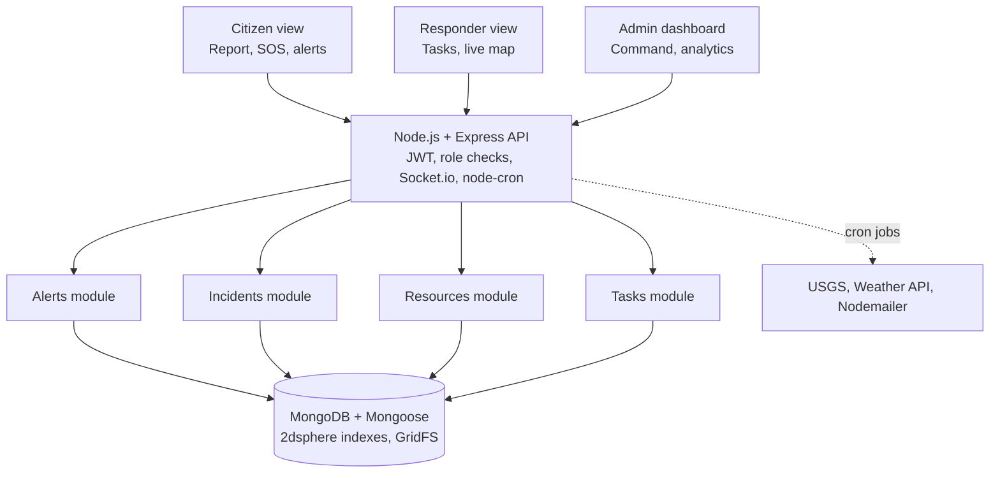

# Disaster Management Portal (Pure MERN)

Ek real-world disaster management portal jisme citizens, responders aur admin ek hi platform par kaam karte hain. Stack: **MongoDB, Express, React, Node.js**. Redis, queue ya extra cloud services use nahi hui hain.

---

## 1. High-level architecture



### Layers

| Layer | Technology | Kaam |
|---|---|---|
| Frontend | React (Vite), React Router, Leaflet + OpenStreetMap, Recharts | UI, live map, dashboards |
| API | Node.js + Express | REST endpoints, auth, validation |
| Real-time | Socket.io (Node ke andar) | Live alerts, task updates, map updates |
| Scheduled jobs | node-cron | External feeds check karna, pending alerts bhejna |
| Database | MongoDB + Mongoose | Sab data, geo queries, photos (GridFS) |
| Email | Nodemailer | Email alerts |

> Shuru mein **modular monolith** rakho: ek Express app, har module ke alag routes, controllers aur models. Microservices ki zarurat nahi.

---

## 2. Features

### Citizens
- Live map: incidents, danger zones, shelters
- SOS button (GPS location ke saath)
- Incident report form (type, description, photo)
- "I'm safe" check-in aur missing person report
- Nearest shelter finder
- Emergency contacts aur safety guides

### Responders / Volunteers
- Task accept ya decline
- Status update: `assigned` → `en route` → `on site` → `done`
- Real-time task aur map updates (Socket.io)
- Field notes aur photos

### Admin
- Citizen reports verify karna (unverified report public map par nahi dikhti)
- Zone draw karke alert bhejna (Socket.io + email)
- Shelter aur resource inventory management (food, medicine, boats, vehicles)
- Responder tasks assign karna
- Analytics: incident heatmap, response time, resource usage
- Audit log: kisne kab kya kiya

---

## 3. Real-world requirements (bina extra tools ke)

| Zarurat | Solution |
|---|---|
| Net kharab ho to bhi kaam kare | React PWA: service worker + IndexedDB, net aate hi sync |
| "5 km ke andar shelter", "zone ke andar users" | MongoDB `2dsphere` index + GeoJSON |
| Auto disaster detection | `node-cron` har kuch minute mein USGS aur weather API check kare, admin ke liye draft alert banaye |
| Fake reports | Report ka status `unverified` se shuru, admin approve kare tab public ho |
| Alert queue (Redis ke bina) | `alerts` collection mein `status: pending / sent`, cron job process kare |
| Photos | Multer + GridFS (MongoDB ke andar) |
| Security | JWT, role-based access, `helmet`, `express-rate-limit` (SOS spam rokne ke liye) |
| Multi-language | `react-i18next` (Hindi + English) |

---

## 4. Main collections

| Collection | Important fields |
|---|---|
| `users` | name, email, passwordHash, role (`citizen`, `responder`, `admin`), phone, lastLocation (GeoJSON) |
| `incidents` | type, severity, description, location (GeoJSON), photos, status (`unverified`, `verified`, `resolved`), reportedBy |
| `alerts` | title, message, severity, zone (GeoJSON polygon), status (`draft`, `pending`, `sent`), createdBy |
| `zones` | name, polygon (GeoJSON), riskLevel |
| `shelters` | name, location (GeoJSON), capacity, occupancy, contact |
| `resources` | type, quantity, minThreshold, locationRef |
| `tasks` | incidentId, assignedTo, status, notes, timestamps |
| `checkins` | userId, status (`safe`, `need_help`), location, createdAt |
| `auditLogs` | actor, action, target, createdAt |

> Jahan location ho wahan GeoJSON store karo aur `2dsphere` index lagao.

---

## 5. Suggested folder structure

```
disaster-management-portal/
├── client/                      # React (Vite)
│   └── src/
│       ├── components/
│       ├── pages/               # Citizen, Responder, Admin
│       ├── hooks/
│       ├── services/            # API + socket helpers
│       ├── context/             # Auth context
│       ├── i18n/
│       └── sw.js                # Service worker (offline)
├── server/
│   ├── src/
│   │   ├── config/              # db, env
│   │   ├── models/
│   │   ├── controllers/
│   │   ├── routes/
│   │   ├── middleware/          # auth, roles, rateLimit, errors
│   │   ├── sockets/             # Socket.io handlers
│   │   ├── jobs/                # node-cron jobs (feeds, alert sender)
│   │   ├── utils/
│   │   └── app.js
│   └── server.js
├── .env.example
└── README.md
```

---

## 6. API overview

| Module | Endpoints (examples) |
|---|---|
| Auth | `POST /api/auth/register`, `POST /api/auth/login`, `GET /api/auth/me` |
| Incidents | `POST /api/incidents`, `GET /api/incidents?lat&lng&radius`, `PATCH /api/incidents/:id/verify` |
| Alerts | `POST /api/alerts`, `GET /api/alerts/active`, `PATCH /api/alerts/:id/send` |
| Shelters | `GET /api/shelters/nearby?lat&lng`, `POST /api/shelters`, `PATCH /api/shelters/:id` |
| Resources | `GET /api/resources`, `POST /api/resources`, `PATCH /api/resources/:id` |
| Tasks | `POST /api/tasks`, `GET /api/tasks/mine`, `PATCH /api/tasks/:id/status` |
| Check-ins | `POST /api/checkins`, `GET /api/checkins/zone/:zoneId` |
| Analytics | `GET /api/analytics/summary`, `GET /api/analytics/heatmap` |

---

## 7. Build order

1. **Auth aur roles** (citizen, responder, admin)
2. **Incident report + live map** (Leaflet)
3. **Admin verification + alerts** (Socket.io + Nodemailer)
4. **Shelters, resources, responder tasks**
5. **Cron feeds** (USGS, weather), **offline PWA**, **analytics**
6. Testing, security pass, deployment (Render / Railway + MongoDB Atlas free tier)

---

## 8. Future upgrades (optional, baad mein)

- SMS alerts (jab budget ho)
- Push notifications (FCM)
- Redis + queue (jab traffic bahut badhe)
- CAP (Common Alerting Protocol) format support
- Government API integration
